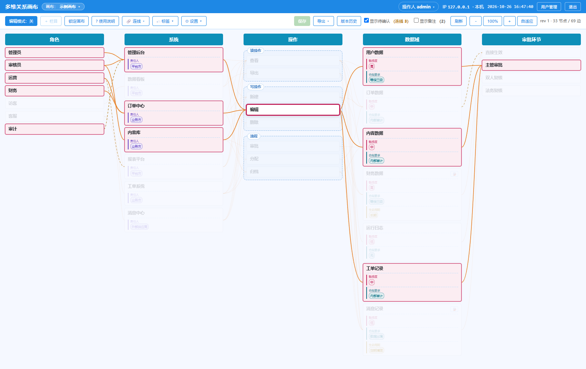
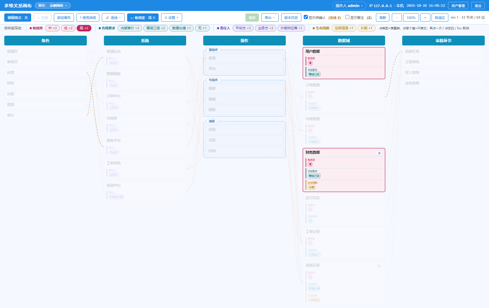
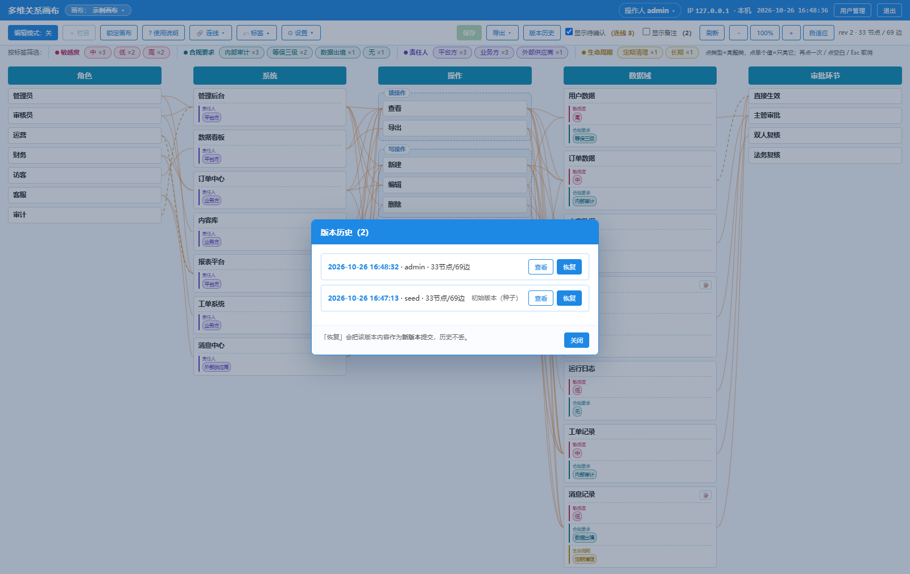

# 多维关系画布 · facet-canvas

> 把「谁归谁」这类**多对多关系**摊在一张**有栏目的画布**上，当场和业务方确认，**每轮确认留一个版本**。
> 零依赖（Node 内置 SQLite）、单目录部署、可完全私有化。



## 这是什么

一句话：**一张受"栏目"约束的关系画布**——栏目是维度，节点是取值，连线是归属；改完点保存，就是一个可回溯的版本。

它**不是**白板，也**不是**流程图工具。它解决的是「多个维度的取值之间谁对应谁」这类**确认**工作。

### 它解决的不是"画图"，是"确认"

典型场景：摸清「角色 × 系统 × 操作 × 审批环节」的权限归属，然后找 5 个团队挨个确认"这条对不对、有没有漏"。

用 Excel 时，一行只能装**一个组合**（哪个角色、在哪个系统、能做哪项操作），于是只剩两条路：

- **把多个值塞进一个单元格**（写成 `查看/新建/编辑`）→ 筛选、比对、统计立刻全废
- **每个组合单独一行**，保住可筛选 → 组合数按各维取值的乘积增长，几百行里翻找一条关系，注意力很快就散了

两条路都解决不了真正的问题：**"哪个角色漏了哪项操作"依然只能一行行用眼睛扫。**

换成画布之后：

- **栏目 = 维度**：关系被约束在列里，不会像白板那样越画越散
- **节点 = 取值**、**连线 = 归属**：一张图看全 N:N，不用在表格里翻页找对应
- **点一个节点 → 上下游全亮**：直接回答"这条链路通不通、缺哪一段"
- **保存 = 一轮确认**：每轮留一个版本，谁改的、改了什么、能不能退回去

## 它是怎么帮你分析的（一个例子）

以自带的示例画布为例，一个真实会问的问题：**「"编辑"这项操作，到底牵动什么？」**

**① 点一下「编辑」**（就是上面那张图）

- **往左**：哪几个系统能发出这项操作（管理后台 / 订单中心 / 内容库），它们又归哪些角色
- **往右**：会动到哪些数据域（用户数据 / 内容数据 / 工单记录），最后走哪个审批环节
- **其余 20 个节点自动置灰**——不用自己一个个排除，视线自然落在这一条链上

**② 换个问法：「哪些数据是高敏感的？」**

点标签条上的「高」，画布立刻只剩 2 个节点（用户数据、财务数据）。
这是**另一个维度**的筛选：不看连线，只看"谁带了这个标签"。

**③ 一轮确认完，点保存**

每次保存都生成一个版本，可以查看、可以恢复——"这一版是谁、什么时候、改了多少"都留着。

| 标签筛选：只看高敏感 | 版本历史：每轮确认留痕 |
|---|---|
|  |  |

> 这三步就是这类活的基本节奏：**定一个维度看链路 → 换维度看覆盖 → 存一版留痕**。

## 什么时候适合 / 不适合

| 适合 | 不适合 |
|---|---|
| 多维度归属确认：角色×权限、系统×数据表、条款×产品、需求×用例… | 画流程图 / 架构图（用 draw.io、Excalidraw） |
| 要拿给**非技术同事**当面捋一遍、当场改 | 实时协作白板（Miro、Figma） |
| 每一轮确认都要**留痕、能回溯** | 纯数据建模（ER 工具、数据库） |
| 内网部署、零依赖、一个目录备份 | 需要毫秒级并发协同（本项目是 8 秒轮询 + 乐观锁） |

> 换句话说：**它把"确认"当成一等公民**。如果你只是想把图画出来，用别的工具更省事。

## 核心能力

| | |
|---|---|
| **结构化画布** | 栏目 = 维度、节点 = 取值、连线 = 归属；同栏可分组（虚线框，不参与连线） |
| **链路高亮** | 点节点亮上下游（**按栏目顺序判定**，不按箭头方向）；Ctrl 多选取交集，越选越少 |
| **标签与类型** | 标签可归入类型（分色）；**同一个词可同时属于多个类型**，筛选按 (类型, 名字) 独立生效 |
| **版本** | 每次保存生成一个版本，可查看 / 恢复；恢复也是一次新版本，历史不丢 |
| **多人** | 令牌 + 乐观锁：别人先保存了会提示冲突，不会静默覆盖 |
| **账号** | 管理员 / 可编辑 / 只读三档；改角色、删用户**立即生效**；只读账号可导出 |
| **多画布** | 一张画布一个视角，可复制（栏目/节点/连线全带过去） |
| **导出** | 整图 PNG（2 倍分辨率，含分组框与标签）/ 链路表 CSV |
| **零依赖部署** | `node server.js` 即跑；数据全在 `data/` 一个目录，备份就是拷这个目录 |
| **数据体检** | `verify.js`（只读）输出各表内容指纹，升级前后可比对，有差异退出码 1 |

## 快速开始

```bash
cd facet-canvas
node server.js        # → http://localhost:3000
```

- **Node 22.5+**（用内置 `node:sqlite`；**22.x 要加 `--experimental-sqlite`**，24+ 直接跑）
- **不需要 `npm install`、不需要构建**——前端是三个原生文件（`index.html` + `app.js` + `style.css`）
- 首次启动自动建库 + 播种一份**中性示例**（权限治理：5 栏 / 33 节点 / 69 连线 / 4 类标签 / 3 组）+ 建好管理员

**第一次登录**

| 用户名 | 初始密码 |
|---|---|
| `admin` | `ES9kxuDLUyNfyzEfQtTEWhnNKM` |

> 这个密码写在源码里（公开仓库人人可见），所以它是**入场券**：登录后会被**强制改密**，改完才能操作。
> 进去之后在右上角「用户管理」里给同事建账号（角色三选一，初始密码自动生成、只显示一次）。

**日常三条命令**

```bash
node server.js              # 起服务
node backup.js              # 备份 data/（一致性快照，服务运行中可用）
node verify.js              # 体检：integrity + 各表指纹 + 卫生检查
npm test                    # 冒烟测试（临时实例，不碰你的 data/）
```

## 文档

| 文档 | 内容 |
|---|---|
| [AGENTS.md](AGENTS.md) | **给 AI agent / 贡献者的工作指南**：架构地图、铁律、命令、文档规则、变更流程、禁区 |
| [docs/README.md](docs/README.md) | 文档地图 + spec/plan 模板 + 规模分级 |
| [docs/usage.md](docs/usage.md) | 使用手册：运行参数、编辑操作、快捷键、多画布、标签与类型、导出 |
| [docs/data-model.md](docs/data-model.md) | 表结构、兼容策略、HTTP 接口、`verify.js` 体检口径 |
| [docs/auth.md](docs/auth.md) | 账号与权限：怎么用 |
| [docs/designs/](docs/designs/) | 关键取舍：为什么这么设计、否掉了哪些方案（改架构前先看） |
| [docs/CHANGELOG.md](docs/CHANGELOG.md) | 变更记录（版本历史的唯一记录处） |
| [DEPLOY.md](DEPLOY.md) | 部署：pm2 / systemd / Windows 服务 / nginx / 备份迁移 |
| [CONTRIBUTING.md](CONTRIBUTING.md) | 参与贡献：三分钟上手 + 提交前检查 |
| [SECURITY.md](SECURITY.md) | 威胁模型：默认口令、明文库、会话与传输（部署前必读） |

> **自带 agent 说明书**：仓库根的 `AGENTS.md` 是本项目的唯一事实源（架构 / 铁律 / 流程 / 禁区），
> 另附 `CLAUDE.md` 与 `.github/copilot-instructions.md` 两个指针——Claude Code、Cursor、Copilot、CodeBuddy 等都能直接接手，不用重新解释项目。

## 目录

```
facet-canvas/
├── AGENTS.md           # 给 AI agent / 贡献者的工作指南（架构、铁律、流程、禁区）
├── README.md           # 本文件（门面）
├── CONTRIBUTING.md     # 参与贡献：三分钟上手 + 提交前检查
├── CLAUDE.md           # 指向 AGENTS.md 的指针（Claude Code 读它）
├── DEPLOY.md           # 部署 / 反代 / 备份迁移 / 升级
├── server.js           # 后端（HTTP + SQLite + 账号 + 版本），零依赖
├── public/             # 前端三件套（原生，无构建）
├── lib/geo.js          # 离线 IP 归属地（读 vendor/ip2region_v4.xdb，缺文件则只显示 IP）
├── backup.js           # 备份（VACUUM INTO 一致性快照 + 拷图）
├── verify.js           # 数据体检（只读）
├── test/               # smoke.js（冒烟）+ docs-consistency.js（文档一致性）
├── seed.json           # 首次播种的中性示例
├── package.json        # 只有脚本与版本号（无依赖）
├── LICENSE             # Apache-2.0
├── docs/               # 使用手册 / 数据模型 / 账号 / 决策记录 / 任务文档 / 截图
├── data/               # 【运行时】库 + 图片；gitignore，备份就备份这一个目录
└── .github/            # workflows/ci.yml + copilot-instructions.md
```

## 已知限制

- **撤销/重做只在当前会话内**（不持久化、不跨刷新）；要协作级撤销得另设计操作日志
- **协同是 8 秒轮询 + 乐观锁**，不是实时同步；两人同时改会提示冲突
- **单实例**：SQLite 单文件库，不要多进程指向同一个 `data.db`
- **明文 HTTP**：公网部署必须套 HTTPS + 网关收窄（见 DEPLOY.md）
- 改密码**不会踢掉其他已登录设备**（令牌无版本号），需要的话可加 `token_version`

## 后续可能的改进

- 令牌版本号（改密即踢下线）
- 用户组 / 项目级权限（目前是整站一套权限）
- 更多导出格式（SVG / Markdown 大纲）
- 拖拽连线、框选批量编辑的交互打磨

## 许可

[Apache-2.0](LICENSE) —— 含专利授权，商用与二次分发都友好。
